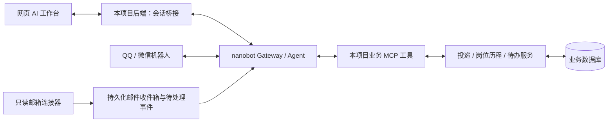
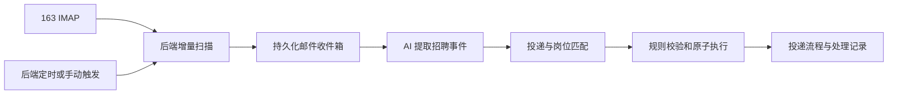

# AI 工作台与邮箱自动化设计讨论稿

首次记录为 2026-10-27，最近补充为 2026-11-09（北京时间）。163 邮件同步已进入实现与联调阶段，其他工作台与机器人内容保留为历史方案讨论。

## 当前决策（2026-11-09）

用户最新决定暂时继续采用原生实现，首版邮箱范围仍为 163。邮件分析采用固定两轮独立模型请求，第一轮提取事件和公司检索关键词，后端逐关键词查询并合并候选，第二轮从候选中选择公司。当前模型调用通过 HTTPX 与统一 `llm_chat` 入口组织，后端任务服务负责收件和调度，既有业务服务负责规则和数据库事务。LangChain 保留为后续可评估的框架。

2026-10-27 的 nanobot 内容属于早期方案讨论，当前设计以本节和后文 163 邮件方案为准。

## 历史需求与方向（2026-10-27）

用户希望通过一个 AI 对话入口管理求职流程：发送投递截图后自动填写投递记录；读取邮箱并生成页面待办；通过 QQ、微信机器人操作同一份求职数据。用户随后明确：“本意也是基于 nanobot 做这个 agent”。

在当时的讨论中，用户明确提出基于 nanobot 与机器人入口。下文至 163 邮件方案之前的服务拆分、接口与开发顺序记录该阶段的建议。

## 当前源码依据

- 本项目的 [jobs/router.py](../backend/app/modules/jobs/router.py)、[jobs/service.py](../backend/app/modules/jobs/service.py) 已提供投递、岗位历史、轮次与日程的业务能力；[todo/router.py](../backend/app/modules/todo/router.py)、[todo/service.py](../backend/app/modules/todo/service.py) 已提供待办能力。应复用这些业务规则，避免 Agent 另写一套数据库操作。
- [模块注册](../backend/app/core/module_registry.py)和[前端模块表](../frontend/src/modules/index.ts)可承载新的 assistant 入口。现有 AI 面试继续保留为独立业务流程。
- 现有 [模型调用](../backend/app/modules/aitools/service.py)主要返回文本，没有完整的工具调用循环。接入 nanobot 时，不应把一次普通模型请求误当成整个 Agent 工作流。
- 本机 nanobot 检出标识为 `04974b76`；其 `nanobot/agent/tools/mcp.py` 支持 MCP，`nanobot/agent/plugins.py` 支持插件清单、Skill 及 MCP 配置。它们分别承担能力调用、工作指引和组件配置，Skill 不能替代工具实现或服务端授权。
- nanobot 的 `nanobot/api/server.py` 已有 `/v1/chat/completions`、显式 `session_id`、流式文本和可配置的 Bearer 鉴权。未传会话标识会进入默认会话；因此不能把所有网页用户都直接转发到默认会话。此接口并不自动提供完整的业务操作卡片与跨渠道任务同步。
- 本机 nanobot 存在 `channels/qq/`、`channels/weixin/`、`channels/email/` 和定时任务代码。存在实现不等于本项目已配置机器人、账号授权或完成真实收发验证。

## 推荐边界：业务项目 + 独立 nanobot 运行时

保留当前项目与 nanobot 的独立代码、依赖环境和进程。新增的业务工具、工作台桥接和集成配置模板由本项目维护；按版本安装或配置到 nanobot 工作区，不复制 nanobot 源码，也不依赖 Git 忽略的 references 目录运行。

图中的邮件事件到 Agent 需要触发适配；MCP 工具本身不等于事件订阅。初期可由 nanobot 定时任务调用增量读取工具，后续按需要增加事件驱动。

| 层 | 负责 | 边界 |
| --- | --- | --- |
| Vue 工作台 | 对话、附件、操作结果卡片、跳转业务详情 | 不保存机器人或服务端调用密钥 |
| 当前 FastAPI 后端 | 业务数据、字段校验、事务、权限、操作记录和工作台桥接 | 业务数据库为事实依据 |
| 业务 MCP 适配层 | 将明确的业务动作包装成类型化工具 | 在服务器侧调用既有业务服务，不直接让模型执行 SQL |
| nanobot | 模型推理、工具选择、多步任务、会话、渠道和调度 | 通过工具操作业务，不导入本项目 ORM 或直接打开业务数据库 |
| 集成插件 / Skill | MCP 声明、求职操作指引与配置模板 | 凭据放在私有配置，实际权限由后端执行 |
| 邮箱连接器 | 邮箱授权、增量读取、原始来源与处理游标 | 招聘邮件是待分析材料，不是已授权的用户指令 |

这里的解耦是数据和运行时边界清晰，仍然需要稳定的业务工具契约。HTTP/MCP 协议、工具输入输出及错误语义需要版本管理；不是增加一次网络调用就自然获得低耦合。

## 两条不同方向的接口

1. **工作台 → Agent**：网页请求由本项目后端转发到 nanobot 的受认证接口，管理用户与会话映射、附件、流式响应及请求标识。网页只连接本项目，不持有 nanobot 服务密钥。优先评估已有对话 API；完整工具进度与操作卡片需要单独核对事件协议并补适配，不能只根据文本流推断工具执行成功。
2. **Agent → 业务后端**：提供受控的 MCP 工具，例如查询投递、读取指定投递、提交投递变更、创建待办、查询操作结果。工具在后端复用现有服务及事务；MCP 与网页原有 REST 接口共享业务实现。

建议让新增业务 MCP 端点使用独立的服务认证与最小权限范围，不把原有本机设置接口直接暴露给机器人。身份来自可信会话和绑定关系，不能允许模型仅通过一个 userId 参数选择任意数据。

## 三个场景如何落地

### 截图 → 投递记录

推荐流程：上传或机器人附件 → 多模态识别 / OCR → 结构化候选字段与截图依据 → 查询已有投递 → 新增或更新 → 返回已提交结果和详情入口。

- 复用 nanobot 的附件与模型能力，另行验证所选模型的图像理解和工具调用支持；当前项目已有 OCR 可以作为另一种提取方式，不能假定任意现有模型都能读图。
- 区分公司、岗位、日期、地点与流程状态。截图没有的信息保留未知；缺少必填项或匹配到多笔投递时，通过对话补齐。
- 岗位变化必须走已实现的岗位历史逻辑，保留旧阶段与结果，不能直接覆盖数据库字段。
- 明确的新记录可按用户事先设置的自动入库规则直接写入，返回结果卡片；冲突更新或归属不清时才请求确认。不要求每次回到表单重复输入。
- 保存附件来源与操作标识。重发相同消息、网络超时后的重试需要查到已执行结果，避免重复新建。

### 邮箱 → 招聘事件 → 待办

建议先做只读邮箱连接器，再增加招聘事件提取与关联。

本机 nanobot 的 EmailChannel 使用 IMAP 收取邮件，并通过 SMTP 向发件人回复，配置中存在默认开启的自动回复。它原有的定位是“通过邮件与助手对话”。招聘邮件处理中，HR 是资料来源，不是助手主人；仅关闭自动回复也不足以建立所有工具权限边界。

- 根据实际邮箱选择厂商 API / OAuth 或 IMAP 授权方式；本轮没有读取用户邮箱，也没有选定邮箱供应商。
- 增量读取并持久化邮件标识与处理状态。IMAP 归属应包括账号、文件夹、UIDVALIDITY 和 UID，Message-ID 等作为辅助，不能仅以是否未读判断已处理。
- 提取公司、岗位、笔试 / 面试时间及截止时间，附邮件来源；相对日期依据邮件时间与时区解释，歧义保留待确认。
- 原始收件游标与 AI 分析成功状态分别保存：已抓取不等于已分析成功，失败邮件可以重新处理。
- 通过业务工具关联投递、生成待办，基于来源标识和事件类型去重。按自动化规则执行；邮箱来源不能自行取得发信、删除或其他超出任务范围的权限。
- 提醒发给已绑定的本人网页 / QQ / 微信入口，不默认回复招聘邮件发件人。UI 待办继续由当前项目保存。

### QQ / 微信 → 同一份业务数据

渠道复用 nanobot；业务状态统一保存在本项目后端。这里的多端首先是“不同入口操作同一后台”，无需让手机和电脑各持有并复制一份 SQLite。

- 机器人用户标识需要经过配对绑定到工作台所有者；初期即使只有一个使用者，也不能把任意发消息的人都映射成所有者。
- 统一业务数据不等于所有渠道自动共用全部聊天上下文。会话按账号、渠道与对端隔离；需要接续网页任务时显式绑定会话或任务。
- 写入成功以业务工具提交结果为准，包含操作 ID、记录 ID 与详情入口。网页第一期可在对话结束、切回页面时重新获取数据；后续增加带游标的业务事件流，支持重连后补取。
- 本地部署时，关闭网页仍能工作，但电脑、业务后端和 nanobot 必须保持运行。若要求电脑关机后仍能收信和聊天，需要常在线部署与数据访问方案；独立 nanobot 进程本身不会解决离线问题。

## 运行状态、幂等与操作记录

- 聊天记录由 nanobot 的会话体系负责，本项目保存会话映射和必要的展示状态，避免把两份聊天历史都当成权威来源。
- 投递、待办、来源关联和已提交操作由业务后端负责。Agent 的自然语言总结不能取代提交记录。
- 写工具使用持久化幂等键、受校验的参数和操作结果查询。网络超时时先查询结果，再判断是否重试；不同入口重复提交也需要归一到来源与动作。
- 并发更新使用业务版本校验；现有 expectedPositionVersion 只解决岗位流程版本，不能被描述为所有业务字段已具备完整的乐观并发控制。
- 若用户需要撤销，使用有明确作用范围和版本检查的补偿操作；当前不能声称现有项目已提供通用撤销能力。
- 邮件和截图是外部数据，模型提取出的动作仍须通过类型校验、身份权限及用户自动化规则。单靠 Skill 中写一句“不要误操作”不能代替这些机制。

## 分期建议与验收

1. **最小纵向流程**：新增网页工作台，经 nanobot 调用少量投递 / 待办工具，实现“发截图 → 识别 → 对话补齐 → 写入 → 页面可见”。同时验证重试不重复、状态不明确时不猜测、旧岗位历史不被覆盖。
2. **同一工具接 QQ**：复用 nanobot 渠道，验证绑定用户、图片消息、会话隔离，以及机器人写入后网页读取一致。
3. **邮箱增量处理**：先手动请求同步，再接定时触发；验证无新邮件、重复邮件、分析中断、含糊日期与错误关联时的恢复。
4. **接微信与后台通知**：复用当前 nanobot weixin 实现，验证真实账号接入、媒体附件、回复权限与任务结果投递，再完善业务事件流。

此顺序为 AI 建议，不表示用户已授权开始实现以上全部功能。现阶段不需要新增多 Agent 编排，也不以引入消息队列或拆更多服务作为目标。

建议的集成验收包括：同一截图重复发送只产生一次对应写入；Agent 在写入后断开，重连仍能查到真实结果；招聘邮件无法变成用户授权指令；邮件重复处理不重复建待办；QQ / 微信未绑定用户无法访问资料；业务版本冲突时保留用户后来修改的内容。以上均为待实现后的验收目标，目前没有执行。

## 外部接入资料与核查边界

核查日期：2026-10-27。以下仅为接口与接入方式的资料核查，不代表已经完成账号或联调验证。

- [QQ 官方机器人文档仓库](https://github.com/tencent-connect/bot-docs/blob/main/docs/README.md)：提供机器人 API 与消息事件说明，具体可用场景及权限以实际应用后台为准。
- [腾讯微信渠道插件](https://github.com/Tencent/openclaw-weixin/blob/main/README.zh_CN.md)：官方仓库说明扫码登录、文本和媒体消息、长轮询以及后端协议文档。它是可参考的微信接入路径，不要求本项目整体迁移到 OpenClaw；当前本机 nanobot 也已有 weixin 适配实现。
- [企业微信智能机器人接入说明](https://cloud.tencent.com.cn/document/product/1759/121473)：与个人微信机器人属于不同入口。用户已明确希望采用 nanobot 式机器人，本轮没有选定企业微信作为实现。

未安装插件、未连接机器人或邮箱、未改动业务数据库、未运行 Agent 集成测试。文档中列出的未来能力不得直接写成已完成的简历经历。

## 163 邮件驱动投递同步方案（2026-11-09）

### 用户已确定的范围

用户希望自动扫描邮箱，将最新招聘信息交给 AI，并更新项目中的投递流程。首版支持 163，用户已明确开始开发，提供手动扫描及每小时一次定时扫描，首次连接只建立新邮件基线。用户特别提出重复测评邀请、投递邀请等误导邮件的甄别要求。

### 建议的处理链路

用户确定自建这条处理链路，曾选择采用 LangChain，随后改为暂时继续原生实现。扫描、持久化与写入规则由项目维护，结构化提取复用当前模型连接。实现位于 [邮箱模块](../backend/app/modules/mailbox/service.py)，后端定时与手动触发共用任务入口和数据库租约。

### 当前原生实现与未来框架替换边界

当前模型请求由 [统一调用入口](../backend/app/modules/aitools/service.py)通过 HTTPX 完成。模拟面试、面经整理和选择题解析共享该入口，Pydantic 承担结构校验，SQLAlchemy 与 SQLite 保存业务数据和自建任务状态。面经整理还校验公司、岗位和引用文字确实来自对应原文，可选本地 OCR 使用 RapidOCR 与 ONNX Runtime。

若未来仅使用 LangChain 替换底层模型请求，主要改动可集中在 `llm_chat` 及其模型适配辅助函数。保留现有异步消息输入和文本返回约定，并兼容模型设置、账号认证、Chat Completions / Responses、超时及错误语义。提示词、上下文选择、原文依据校验和数据库任务状态由各业务服务维护。具体兼容程度需通过现有连接方式验证。

若进一步采用 LangChain Agent，需要定义业务工具及参数、执行模型与工具之间的循环、传回工具结果、设置停止条件和调用预算，并接入持久化及业务幂等。这部分涉及上层执行逻辑。当前 `llm_chat` 返回文本，完整工具循环需要保留工具调用信息的模型消息接口或独立 Agent 入口。

备选框架 LangChain 提供模型接口、工具与 Agent 抽象，也提供模型相关的结构化输出策略。其 Agent 以 LangGraph 为底层运行时，业务侧通过 LangChain API 使用这些能力。

LangChain 的 `create_agent` 内置 Agent 循环，模型选择工具、执行工具并将工具结果交回模型，重复运行至产出最终答复或达到配置的执行限制。邮箱场景可以先查询候选投递，再根据查询结果读取岗位历史，获得依据后调用受控更新工具。固定的提取和校验步骤可通过普通 Python 服务及模型调用组织，具体执行范围待实现时明确。

定时收件与逐封遍历由后端任务服务组织，Agent 循环处理单次任务中的工具选择。若采用 LangChain Agent，需要具备工具调用能力的模型适配。当前 `llm_chat` 的调用输入与返回以文本消息为主，接入时需核对工具定义、`tool_calls` 或相应 Responses 事件的传递与执行，并设置调用预算、超时和写入幂等边界。

邮件流程中的候选分支如下。

- 明确识别并匹配投递后，进入规则校验与业务写入。
- 匹配存在歧义时保存状态，等待用户关联后继续校验。
- 模型或网络失败时按异常类型和次数限制重试，保留运行状态供恢复。

采用该方案需要定义持久化任务状态、重试边界和依赖版本，并核对现有自定义模型接口与账号连接的兼容性。业务数据库负责邮件游标、处理进度、投递事实、事务和操作记录。Agent 重试时可能重复调用写入，需以来源事件的稳定幂等键查询和提交业务结果。

暂时继续原生实现由用户确定，LangChain 相关内容为后续备选讨论。

### 163 连接与扫描

- 使用 IMAP over SSL，连接 `imap.163.com:993`。设置页提供邮箱地址、客户端授权码、连接测试和定时扫描开关。授权码复用 `private_store`，在 Windows 下使用当前用户的 DPAPI 保存。
- 连接器使用只读选择与 `BODY.PEEK` 获取主题、发件人、收件时间及正文，已读和未读邮件均按增量游标处理。首版提取正文及附件文件名，附件内容需在原邮箱中核对。
- 定时扫描固定每小时一次，手动扫描保留原定时计划。首次连接以最新 UID 建立基线，重新保存同一邮箱保留已建立的增量进度。应用和电脑运行期间执行定时任务，重启后按已保存的游标处理积压新邮件。
- 163 实测在 SELECT 响应中省略游标字段时，通过 STATUS 补取；仍缺少 UIDNEXT 时只查询历史 UID 标识以建立基线。UIDVALIDITY 变化时重新建立基线，保留已有处理记录。
- 邮件唯一键包含账号、文件夹、UIDVALIDITY 和 UID，Message-ID 与内容摘要辅助识别重复。收件进度、AI 分析进度和执行进度分别持久化，失败任务可以独立重试。
- 同一账号的手动同步、定时同步及失败重试共用数据库任务租约，处理应用重启和多个进程重复触发的情况。

### AI 输出与业务匹配

第一轮 AI 根据邮件提取公司、岗位、事件类型、轮次、结果、开始时间、截止时间、原文证据和 1 至 5 个公司检索关键词。后端对去重后的每个关键词分别调用 `search_companies()`，每个查询最多返回 20 个去重公司名，并记录 `hasMore`。查询使用参数绑定和转义后的包含匹配，模型输入的候选并集上限为 100 家。

第二轮为独立请求，输入第一轮的公司原名、岗位、证据、关键词检索结果和候选公司的现有岗位标签，从候选并集中选择 `matchedCompany` 并给出对应类型和理由。每公司最多提供 10 个去重岗位标签，带限量提示。模型同时建议更新已有岗位、新增岗位或待核对，给出 `targetPosition` 与依据。原名及引文检查邮件来源，对应公司检查候选并集。选择已有岗位须命中提供的标签，新建建议须来自已验证的原文材料，具体岗位和代次由后端继续筛选。

公司对应类型支持精确、别名与招聘单位。用户现有岗位已经采用分行、中心等机构标签，且邮件原名明确包含候选公司及单位标识时，可以归属该公司并创建独立岗位。原名涉及子公司、控股或集团等歧义时进入待核对。相对日期依据邮件时间与时区解释，含糊日期进入待关联或待确认记录。

提醒、推广等类别在第一轮后分流，关键词不足或检索结果为空时进入待核对。第二轮失败保留第一轮结果与检索过程，供用户重新分析。前端详情可展开查看各关键词、候选及结果限量提示。

执行目标使用投递 ID、岗位代次、岗位快照及必要的轮次 ID。公司及岗位唯一匹配、关键信息有原文依据且通过业务校验时自动更新。公司多岗位、同名再次投递、时间冲突和无法匹配的邮件进入待核对区。自动执行还核对轮次依据、原文日期与时刻以及阶段推进方向。

内容摘要用于识别完全重复的邮件，事件键和已有轮次安排用于防止同一招聘事件重复写入。模型区分招聘事件、催办提醒、投递邀请、推广、无关邮件与不确定材料。标题明确的职位推荐和投递邀请先归为忽略；已有同类轮次但时间不明确或发生冲突时交由人工选择。邮件推动阶段时只记录有依据的变化，前序轮次结果由实际结果邮件或用户维护。

具体事件按项目现有语义处理。

| 邮件内容 | 通过校验后的业务变化 |
| --- | --- |
| 一面邀请 | 目标岗位进入面试阶段，创建一面轮次，分别保存开始与截止时间 |
| 笔试未通过 | 将已匹配的笔试轮次结果记录为未通过 |
| 正式 Offer 通知 | 目标岗位进入 Offer 阶段，创建正式 Offer 轮次，个人接受决定由用户填写 |
| 已有安排改期 | 根据来源和目标轮次关联更新安排，保留原值与新值的处理记录 |

邮件作为外部招聘材料进入提取流程，执行能力由后端定义的自动化规则授予。记录每次操作引用的邮件、原文证据、匹配目标、修改前后字段及最终执行状态。

### 执行事务与恢复

`create_position`、`patch_position_status`、`create_round`、`update_round` 保留原调用默认提交行为，并支持由上层管理事务。[邮件执行入口](../backend/app/modules/mailbox/execution.py)将新增岗位、岗位状态、轮次、邮件来源、幂等键及变更记录放入同一事务，任何步骤失败都回滚本次业务变更。独立新增岗位使用 `position_version_counter` 分配代次，旧库启动时回填历史最大值，删除后继续保留分配上界。

执行器复用现有岗位状态与轮次规则，使用父记录写锁及岗位记录摘要核对目标岗位、阶段和轮次。新增岗位前检查完整公司快照。待核对页打开后发生的人工修改会使旧确认失效。失败邮件可重新分析，过期任务通过租约接管恢复，已执行的确认请求重复提交时返回已有结果。执行记录区分真实更新、已有相同事件和核对一致，变更摘要解释新增岗位、轮次、时间、结果及阶段变化。

### 界面与验证

「设置 → 163 邮箱」配置连接与定时扫描开关。「AI 工具 → 邮件同步」提供手动扫描、状态筛选、处理原因、正文、原文依据、岗位与轮次选择、公司下新增岗位、确认更新及重试入口。列表筛选和页码使用现有页面状态恢复机制。确认后刷新投递缓存，进入列表、详情、日程及看板时重新加载业务数据，并阻止迟到响应覆盖新数据。查看更新的链接携带岗位代次，详情优先展开对应岗位。

模拟测试覆盖首次基线、只读获取、中文与 HTML 正文、重复内容和重复安排、投递推荐、岗位代次隔离、时间依据、截止时间、事务回滚、过期租约、小时调度、接口确认幂等及陈旧确认拒绝。测试代码见 [邮箱回归](../backend/tests/test_mailbox.py)。

已完成真实 163 连接、保存基线与增量收件。2026-11-10 核对真实邮件记录，确认金山办公已新增笔试，并通过正常人工确认接口为中国银行新增“中国银行软开中心”岗位及测评安排。备份对比确认其他公司记录和中行原有岗位历史一致。DOM 验证覆盖真实记录显示与旧缓存返回后的恢复。新单位归属提示词另以全虚构输入完成两轮真实模型请求，真实邮件识别准确率仍需更多样本测量。小时调度已通过模拟到期条件验证。

### 接入资料

- [阿里云网易邮箱连接说明](https://help.aliyun.com/zh/model-studio/connector/netease-mail)说明 163 的 IMAP 服务启用及客户端授权码接入步骤，并链接网易官方帮助。本轮网易官方帮助页面未能打开。
- [华为官方 163 授权码说明](https://consumer.huawei.com/cn/support/content/zh-cn15872099/)提供网页版开启 IMAP 和获取授权码的步骤。[华为云邮件配置资料](https://support.huaweicloud.com/faq-welink/faq-welink.pdf)列出个人 163 的 IMAP 主机、SSL/TLS 和 993 端口。
- 框架职责依据 [LangChain 概览](https://docs.langchain.com/oss/python/langchain/overview)、[结构化输出](https://docs.langchain.com/oss/python/langchain/structured-output)与 [LangGraph 概览](https://docs.langchain.com/oss/python/langgraph/overview)。恢复和重试方案参照 [持久化](https://docs.langchain.com/oss/python/langgraph/persistence)、[中断](https://docs.langchain.com/oss/python/langgraph/interrupts)与 [容错及幂等边界](https://docs.langchain.com/oss/python/langgraph/fault-tolerance)。
- 循环与控制方式参照 [LangChain Agent 循环](https://docs.langchain.com/oss/python/langchain/agents)和 [工作流与 Agent 模式](https://docs.langchain.com/oss/python/langgraph/workflows-agents)。
