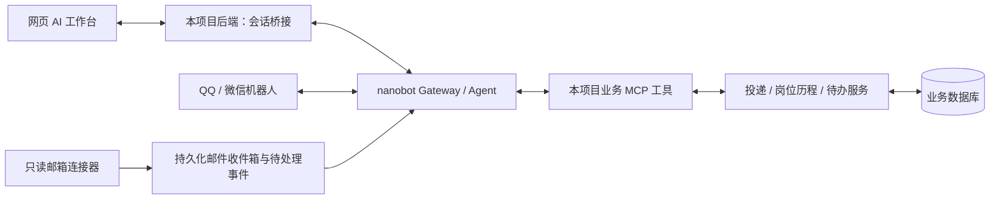

# AI 工作台与 nanobot 集成讨论稿

记录日期：2026-10-27（北京时间）。状态：方案讨论，尚未实施或完成集成验证。

## 用户需求与已确定的方向

用户希望通过一个 AI 对话入口管理求职流程：发送投递截图后自动填写投递记录；读取邮箱并生成页面待办；通过 QQ、微信机器人操作同一份求职数据。用户随后明确：“本意也是基于 nanobot 做这个 agent”。

基于 nanobot 与机器人入口是用户明确的方向。下文的服务拆分、接口、执行策略与开发顺序是 AI 在核对源码后提出的建议，尚未被用户逐项确认。

## 当前源码依据

- 本项目的 [jobs/router.py](../backend/app/modules/jobs/router.py)、[jobs/service.py](../backend/app/modules/jobs/service.py) 已提供投递、岗位历史、轮次与日程的业务能力；[todo/router.py](../backend/app/modules/todo/router.py)、[todo/service.py](../backend/app/modules/todo/service.py) 已提供待办能力。应复用这些业务规则，避免 Agent 另写一套数据库操作。
- [模块注册](../backend/app/core/module_registry.py)和[前端模块表](../frontend/src/modules/index.ts)可承载新的 assistant 入口。现有 AI 面试继续保留为独立业务流程。
- 现有 [模型调用](../backend/app/modules/aitools/service.py)主要返回文本，没有完整的工具调用循环。接入 nanobot 时，不应把一次普通模型请求误当成整个 Agent 工作流。
- 本机 nanobot 检出标识为 `04974b76`；其 `nanobot/agent/tools/mcp.py` 支持 MCP，`nanobot/agent/plugins.py` 支持插件清单、Skill 及 MCP 配置。它们分别承担能力调用、工作指引和组件配置，Skill 不能替代工具实现或服务端授权。
- nanobot 的 `nanobot/api/server.py` 已有 `/v1/chat/completions`、显式 `session_id`、流式文本和可配置的 Bearer 鉴权。未传会话标识会进入默认会话；因此不能把所有网页用户都直接转发到默认会话。此接口并不自动提供完整的业务操作卡片与跨渠道任务同步。
- 本机 nanobot 存在 `channels/qq/`、`channels/weixin/`、`channels/email/` 和定时任务代码。存在实现不等于本项目已配置机器人、账号授权或完成真实收发验证。

## 推荐边界：业务项目 + 独立 nanobot 运行时

保留当前项目与 nanobot 的独立代码、依赖环境和进程。新增的业务工具、工作台桥接和集成配置模板由本项目维护；按版本安装或配置到 nanobot 工作区，不复制 nanobot 源码，也不依赖 Git 忽略的 references 目录运行。

图中的邮件事件到 Agent 需要触发适配；MCP 工具本身不等于事件订阅。初期可由 nanobot 定时任务调用增量读取工具，后续按需要增加事件驱动。

| 层 | 负责 | 边界 |
| --- | --- | --- |
| Vue 工作台 | 对话、附件、操作结果卡片、跳转业务详情 | 不保存机器人或服务端调用密钥 |
| 当前 FastAPI 后端 | 业务数据、字段校验、事务、权限、操作记录和工作台桥接 | 业务数据库为事实依据 |
| 业务 MCP 适配层 | 将明确的业务动作包装成类型化工具 | 在服务器侧调用既有业务服务，不直接让模型执行 SQL |
| nanobot | 模型推理、工具选择、多步任务、会话、渠道和调度 | 通过工具操作业务，不导入本项目 ORM 或直接打开业务数据库 |
| 集成插件 / Skill | MCP 声明、求职操作指引与配置模板 | 凭据放在私有配置，实际权限由后端执行 |
| 邮箱连接器 | 邮箱授权、增量读取、原始来源与处理游标 | 招聘邮件是待分析材料，不是已授权的用户指令 |

这里的解耦是数据和运行时边界清晰，仍然需要稳定的业务工具契约。HTTP/MCP 协议、工具输入输出及错误语义需要版本管理；不是增加一次网络调用就自然获得低耦合。

## 两条不同方向的接口

1. **工作台 → Agent**：网页请求由本项目后端转发到 nanobot 的受认证接口，管理用户与会话映射、附件、流式响应及请求标识。网页只连接本项目，不持有 nanobot 服务密钥。优先评估已有对话 API；完整工具进度与操作卡片需要单独核对事件协议并补适配，不能只根据文本流推断工具执行成功。
2. **Agent → 业务后端**：提供受控的 MCP 工具，例如查询投递、读取指定投递、提交投递变更、创建待办、查询操作结果。工具在后端复用现有服务及事务；MCP 与网页原有 REST 接口共享业务实现。

建议让新增业务 MCP 端点使用独立的服务认证与最小权限范围，不把原有本机设置接口直接暴露给机器人。身份来自可信会话和绑定关系，不能允许模型仅通过一个 userId 参数选择任意数据。

## 三个场景如何落地

### 截图 → 投递记录

推荐流程：上传或机器人附件 → 多模态识别 / OCR → 结构化候选字段与截图依据 → 查询已有投递 → 新增或更新 → 返回已提交结果和详情入口。

- 复用 nanobot 的附件与模型能力，另行验证所选模型的图像理解和工具调用支持；当前项目已有 OCR 可以作为另一种提取方式，不能假定任意现有模型都能读图。
- 区分公司、岗位、日期、地点与流程状态。截图没有的信息保留未知；缺少必填项或匹配到多笔投递时，通过对话补齐。
- 岗位变化必须走已实现的岗位历史逻辑，保留旧阶段与结果，不能直接覆盖数据库字段。
- 明确的新记录可按用户事先设置的自动入库规则直接写入，返回结果卡片；冲突更新或归属不清时才请求确认。不要求每次回到表单重复输入。
- 保存附件来源与操作标识。重发相同消息、网络超时后的重试需要查到已执行结果，避免重复新建。

### 邮箱 → 招聘事件 → 待办

建议先做只读邮箱连接器，再增加招聘事件提取与关联。

本机 nanobot 的 EmailChannel 使用 IMAP 收取邮件，并通过 SMTP 向发件人回复，配置中存在默认开启的自动回复。它原有的定位是“通过邮件与助手对话”。招聘邮件处理中，HR 是资料来源，不是助手主人；仅关闭自动回复也不足以建立所有工具权限边界。

- 根据实际邮箱选择厂商 API / OAuth 或 IMAP 授权方式；本轮没有读取用户邮箱，也没有选定邮箱供应商。
- 增量读取并持久化邮件标识与处理状态。IMAP 归属应包括账号、文件夹、UIDVALIDITY 和 UID，Message-ID 等作为辅助，不能仅以是否未读判断已处理。
- 提取公司、岗位、笔试 / 面试时间及截止时间，附邮件来源；相对日期依据邮件时间与时区解释，歧义保留待确认。
- 原始收件游标与 AI 分析成功状态分别保存：已抓取不等于已分析成功，失败邮件可以重新处理。
- 通过业务工具关联投递、生成待办，基于来源标识和事件类型去重。按自动化规则执行；邮箱来源不能自行取得发信、删除或其他超出任务范围的权限。
- 提醒发给已绑定的本人网页 / QQ / 微信入口，不默认回复招聘邮件发件人。UI 待办继续由当前项目保存。

### QQ / 微信 → 同一份业务数据

渠道复用 nanobot；业务状态统一保存在本项目后端。这里的多端首先是“不同入口操作同一后台”，无需让手机和电脑各持有并复制一份 SQLite。

- 机器人用户标识需要经过配对绑定到工作台所有者；初期即使只有一个使用者，也不能把任意发消息的人都映射成所有者。
- 统一业务数据不等于所有渠道自动共用全部聊天上下文。会话按账号、渠道与对端隔离；需要接续网页任务时显式绑定会话或任务。
- 写入成功以业务工具提交结果为准，包含操作 ID、记录 ID 与详情入口。网页第一期可在对话结束、切回页面时重新获取数据；后续增加带游标的业务事件流，支持重连后补取。
- 本地部署时，关闭网页仍能工作，但电脑、业务后端和 nanobot 必须保持运行。若要求电脑关机后仍能收信和聊天，需要常在线部署与数据访问方案；独立 nanobot 进程本身不会解决离线问题。

## 运行状态、幂等与操作记录

- 聊天记录由 nanobot 的会话体系负责，本项目保存会话映射和必要的展示状态，避免把两份聊天历史都当成权威来源。
- 投递、待办、来源关联和已提交操作由业务后端负责。Agent 的自然语言总结不能取代提交记录。
- 写工具使用持久化幂等键、受校验的参数和操作结果查询。网络超时时先查询结果，再判断是否重试；不同入口重复提交也需要归一到来源与动作。
- 并发更新使用业务版本校验；现有 expectedPositionVersion 只解决岗位流程版本，不能被描述为所有业务字段已具备完整的乐观并发控制。
- 若用户需要撤销，使用有明确作用范围和版本检查的补偿操作；当前不能声称现有项目已提供通用撤销能力。
- 邮件和截图是外部数据，模型提取出的动作仍须通过类型校验、身份权限及用户自动化规则。单靠 Skill 中写一句“不要误操作”不能代替这些机制。

## 分期建议与验收

1. **最小纵向流程**：新增网页工作台，经 nanobot 调用少量投递 / 待办工具，实现“发截图 → 识别 → 对话补齐 → 写入 → 页面可见”。同时验证重试不重复、状态不明确时不猜测、旧岗位历史不被覆盖。
2. **同一工具接 QQ**：复用 nanobot 渠道，验证绑定用户、图片消息、会话隔离，以及机器人写入后网页读取一致。
3. **邮箱增量处理**：先手动请求同步，再接定时触发；验证无新邮件、重复邮件、分析中断、含糊日期与错误关联时的恢复。
4. **接微信与后台通知**：复用当前 nanobot weixin 实现，验证真实账号接入、媒体附件、回复权限与任务结果投递，再完善业务事件流。

此顺序为 AI 建议，不表示用户已授权开始实现以上全部功能。现阶段不需要新增多 Agent 编排，也不以引入消息队列或拆更多服务作为目标。

建议的集成验收包括：同一截图重复发送只产生一次对应写入；Agent 在写入后断开，重连仍能查到真实结果；招聘邮件无法变成用户授权指令；邮件重复处理不重复建待办；QQ / 微信未绑定用户无法访问资料；业务版本冲突时保留用户后来修改的内容。以上均为待实现后的验收目标，目前没有执行。

## 外部接入资料与核查边界

核查日期：2026-10-27。以下仅为接口与接入方式的资料核查，不代表已经完成账号或联调验证。

- [QQ 官方机器人文档仓库](https://github.com/tencent-connect/bot-docs/blob/main/docs/README.md)：提供机器人 API 与消息事件说明，具体可用场景及权限以实际应用后台为准。
- [腾讯微信渠道插件](https://github.com/Tencent/openclaw-weixin/blob/main/README.zh_CN.md)：官方仓库说明扫码登录、文本和媒体消息、长轮询以及后端协议文档。它是可参考的微信接入路径，不要求本项目整体迁移到 OpenClaw；当前本机 nanobot 也已有 weixin 适配实现。
- [企业微信智能机器人接入说明](https://cloud.tencent.com.cn/document/product/1759/121473)：与个人微信机器人属于不同入口。用户已明确希望采用 nanobot 式机器人，本轮没有选定企业微信作为实现。

未安装插件、未连接机器人或邮箱、未改动业务数据库、未运行 Agent 集成测试。文档中列出的未来能力不得直接写成已完成的简历经历。
